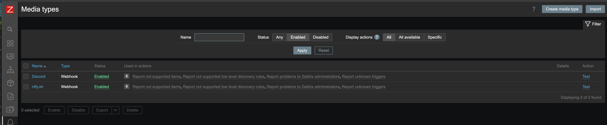
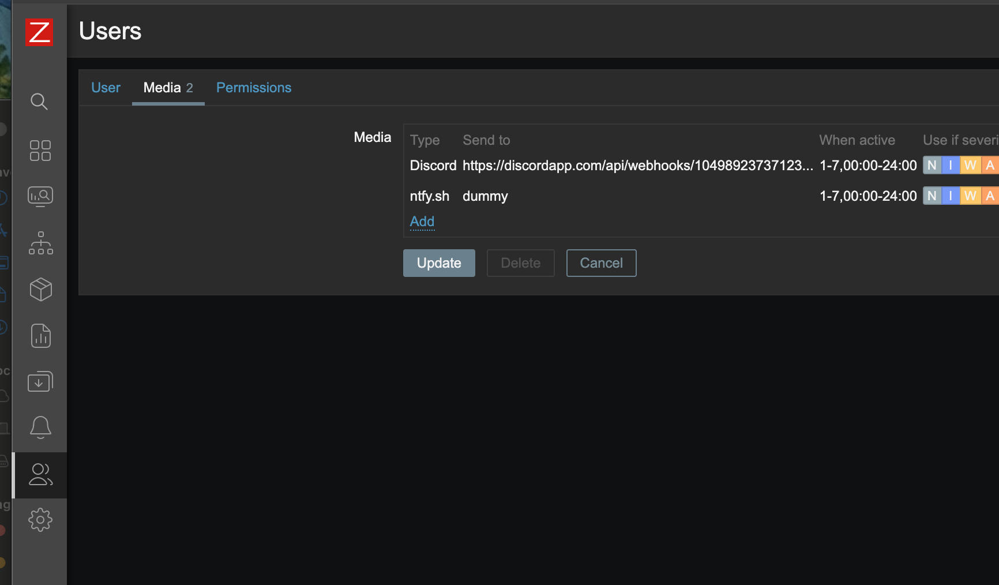

# zabbix-ntfy

A Zabbix webhook media type that sends notifications to [ntfy](https://ntfy.sh).
Works with the ntfy apps for [iOS](https://apps.apple.com/nl/app/ntfy/id1625396347) and
[Android](https://play.google.com/store/apps/details?id=io.heckel.ntfy), or anything else that
subscribes to an ntfy topic.

The project started as a personal setup and is maintained in spare time. Pull requests are welcome;
there is no support commitment beyond best effort.

## Install

1. Download `zbx_ntfy.yaml`.
2. In Zabbix go to **Alerts → Media types** and click **Import**.
   

## Configuration

### Global macros

**Administration → Macros**. Only `{$NTFY.URL}` is required.

| Macro | Required | Description |
| :--- | :--- | :--- |
| `{$NTFY.URL}` | yes | Base URL of your ntfy instance, e.g. `https://ntfy.sh`. |
| `{$NTFY.SENDTO}` | no | Topic used for all alerts. Lets you keep one topic in one place instead of per user. |
| `{$NTFY.TOKEN}` | no | ntfy access token, sent as `Authorization: Bearer <token>`. |
| `{$NTFY.USER}` / `{$NTFY.PASS}` | no | Username and password for HTTP basic auth, used only when no token is set. |
| `{$ZABBIX.URL}` | no | URL to your Zabbix frontend; sent as the `Click` header so the notification opens Zabbix. |
| `{$HTTP_PROXY}` | no | Proxy for the webhook, e.g. `http://proxy.example:3128`. |

Auth is optional. Leave the token and user/password macros undefined if your topic allows anonymous
publish — the webhook then sends no `Authorization` header at all.

> **Upgrading from an earlier release:** the previous script sent the *literal* text
> `Authorization: *** {$NTFY.TOKEN}` when the token macro was not defined, and `***` instead of
> `Bearer` when it was. Both produced `401 Unauthorized`. Re-import `zbx_ntfy.yaml` and the problem
> goes away.

### User media

**Users → Users → your user → Media**:

1. Add the **ntfy.sh** media type.
2. **Send to** must contain a topic name. If you use `{$NTFY.SENDTO}`, any placeholder works
   (`dummy` is fine) because the topic comes from the macro.
   

## Troubleshooting

Check **Reports → Action log** in the frontend, or `zabbix_server.log` on the server.

| Message | Cause |
| :--- | :--- |
| `Missing required URL or Topic!` | `{$NTFY.URL}` or the topic is empty. |
| `Sending failed: HTTP response code: 401` | ntfy rejected the credentials. Either a wrong token, or the token macro is undefined in an older release (see upgrade note). |
| `Sending failed: HTTP response code: 404` | Wrong topic or URL. |
| `Nseverity value must be passed as an int` | Zabbix could not resolve `{EVENT.NSEVERITY}`; check the media type was imported for the same Zabbix version. |

## Credits

- [PaulSorensen/zabbix-ntfy](https://github.com/PaulSorensen/zabbix-ntfy) — emoji tags, credential
  logging hygiene and HTTP status checking were backported from that fork.
- Listed in the [ntfy integrations](https://docs.ntfy.sh/integrations/#projects-scripts) page and
  discussed in the [Zabbix forum](https://www.zabbix.com/forum/zabbix-cookbook/475107-how-to-add-the-ntfy-sh-notification-service-as-media-type-in-zabbix).
